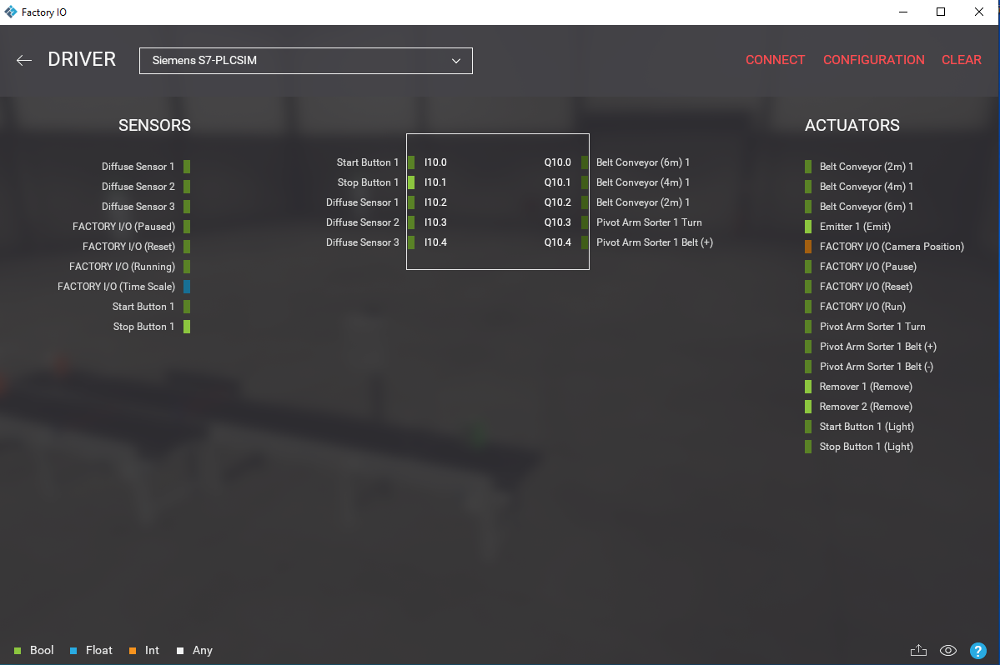

# Pivot Arm Sorter – S7-300 PLC Control with Factory I/O



▶️ **Demo video:** [factory_io/pivot_video.mp4](factory_io/pivot_video.mp4)

A beginner automation project: a Siemens S7-300 PLC program that runs a conveyor line in **Factory I/O** and controls a **pivot arm sorter**. When a box reaches the pivot arm, a sensor detects it and the arm turns for 2 seconds to divert the box, then returns to its home position.

---

## Tools

| Tool | Details |
|---|---|
| SIMATIC Manager (STEP 7 V5.x) | PLC programming and hardware configuration |
| PLC | SIMATIC 300 Station – CPU 312 |
| S7-PLCSIM | PLC simulation |
| Factory I/O | 3D plant simulation – driver: Siemens S7-PLCSIM |
| Programming language | LAD (exported as STL source) |

---

## Sequence of Operation

1. **Start** – Pressing the Start button latches the run memory bit `"x"` (M0.0).
2. **Conveyors run** – While the system is running, conveyors 2, 4 and 6 and the pivot arm belt run continuously.
3. **Box detected** – When `"sensor2"` detects a box at the pivot arm, the arm turns (`"pelt move"`) and holds itself on.
4. **Timed return** – An on-delay timer (T1, 2 s) starts when the arm turns. When it finishes, M0.4 releases the arm and it returns home.
5. **Stop** – Pressing Stop (normally closed button) breaks the latch and stops the conveyors.

---

## I/O List

Symbol names are shown exactly as they appear in the PLC program.

### Inputs
| Address | Symbol | Description |
|---|---|---|
| I10.0 | `start` | Start push button (NO) |
| I10.1 | `stop` | Stop push button (NC – signal is 1 when not pressed) |
| I10.3 | `sensor2` | Box detection sensor at the pivot arm |
| I10.4 | `sensor3` | Sensor 3 – wired, not used in this version |

### Outputs
| Address | Symbol | Description |
|---|---|---|
| Q10.0 | `coveyor 6` | Conveyor 6 motor |
| Q10.1 | `conveyor 4` | Conveyor 4 motor |
| Q10.2 | `conveyor2` | Conveyor 2 motor |
| Q10.3 | `pelt move` | Pivot arm sorter – turn |
| Q10.4 | `pelt +` | Pivot arm sorter – belt forward (+) |

### Internal
| Address | Symbol | Description |
|---|---|---|
| M0.0 | `x` | Start/stop latch – system is running |
| M0.4 | – | Pivot arm hold time elapsed (timer done) |
| T1 | – | On-delay timer, 2 s – pivot arm hold time |

---

## Program Structure

All logic is in **OB1** (main cycle), in 4 networks:

| Network | Function |
|---|---|
| 1 | Start/stop latch – `(start OR x) AND stop = x` |
| 2 | Run conveyors 2, 4, 6 and the pivot arm belt while the system is running |
| 3 | Pivot arm turn – triggered by `sensor2`, self-holding until M0.4 |
| 4 | 2-second on-delay timer (T1) for the pivot arm hold time |

The full program is available as readable text in [`source/OB1_source.AWL`](source/OB1_source.AWL).

---

## Folder Structure

```
pivot_project_1/
├── README.md
├── siemens_software/
│   └── Pivot_FP_v1.0.zip        ← full SIMATIC Manager project archive
├── source/
│   ├── OB1_source.AWL           ← OB1 program as STL text
│   ├── Pivot_FP_Symbols.sdf     ← symbol table (I/O list)
│   └── pivot_fp_hw.cfg          ← hardware configuration
└── factory_io/
    ├── Pivot Arm.factoryio      ← Factory I/O scene
    ├── pivot.PNG                ← scene screenshot
    └── pivot_video.mp4          ← demo video
```

---

## How to Run

1. Download `siemens_software/Pivot_FP_v1.0.zip`.
2. In SIMATIC Manager: **File → Retrieve**, select the zip and choose an empty destination folder.
3. Open the project, start **S7-PLCSIM**, set the CPU to **RUN-P**, and download the station (hardware + blocks).
4. Open `factory_io/Pivot Arm.factoryio` in Factory I/O.
5. In Factory I/O: **File → Drivers**, select **Siemens S7-PLCSIM**, connect, and check the I/O mapping matches the I/O list above.
6. Start the simulation and press **Start**.

---

## Known Limitations & Next Improvements

- **Stop during a pivot move:** if Stop is pressed while the arm is turning, the timer resets but the arm's self-holding branch is not interlocked with the run bit `"x"`, so the arm can stay turned. Fix: put `"x"` in series with the whole of Network 3.
- `sensor3` is wired but not used yet.
- Next versions: descriptive symbol names, logic split into FCs (e.g. FC1 conveyors, FC2 pivot arm), sorting by box type, and a WinCC HMI screen.

---

## Skills Demonstrated

- Start/stop latching (self-holding) circuit
- On-delay timer (S5 timer `SD`)
- Sensor-triggered actuator control
- Testing with S7-PLCSIM and a Factory I/O digital twin
- Project archiving and source export for version control

---

**Author:** Saif Aldin Hany – [GitHub](https://github.com/SaifHani)
